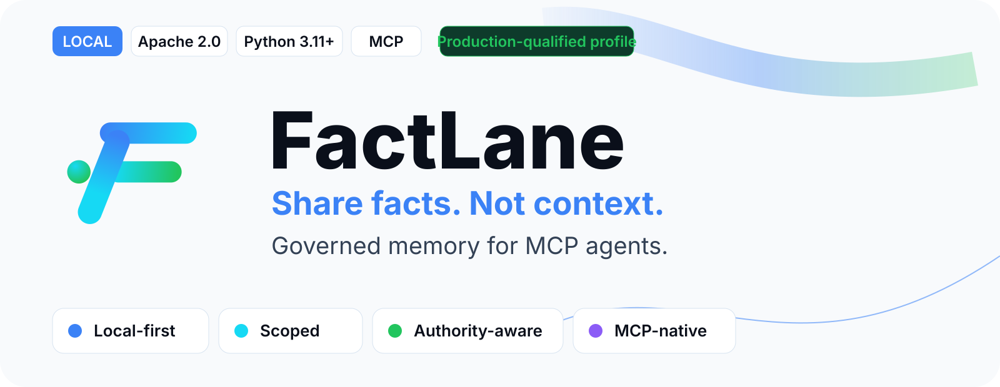
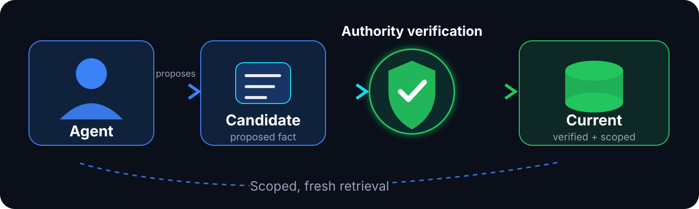

<h1 align="center">
<picture>
  <source media="(max-width: 600px) and (prefers-color-scheme: dark)" srcset="docs/assets/brand/readme/factlane-readme-hero-mobile-dark.svg">
  <source media="(max-width: 600px) and (prefers-color-scheme: light)" srcset="docs/assets/brand/readme/factlane-readme-hero-mobile-light.svg">
  <source media="(prefers-color-scheme: dark)" srcset="docs/assets/brand/readme/factlane-readme-hero-dark.svg">
  <source media="(prefers-color-scheme: light)" srcset="docs/assets/brand/readme/factlane-readme-hero-light.svg">
  
</picture>
</h1>

<div align="center">
<br>

[Quick Start](#quick-start) · [How it works](#how-factlane-works) · [Owner control](#owner-control-plane) · [Architecture](docs/ARCHITECTURE.md) · [Security](SECURITY.md) · [Changelog](docs/CHANGELOG.md)

</div>

---

## Memory that can help without becoming authority

FactLane is a local-first MCP memory layer for AI-agent hosts. It stores **bounded reusable facts** with exact scope, provenance, freshness, lifecycle state, and governed authority so an agent can reuse durable context without treating an old conversation or an unverified contribution as current truth.

The design is intentionally narrow:

- **Candidate → Current governance** — a fact can be worth retaining without being trusted as current.
- **Current truth stays above memory** — current user instructions, live project/product state, and verified live sources can outrank remembered facts.
- **Exact scopes** — facts stay inside explicit user, project, workflow, tool-environment, or governed cross-project boundaries.
- **Local-first runtime** — the supported profile uses local SQLite/SQLite-vec storage and local Ollama embeddings.
- **Small MCP contract** — exactly five public tools over command-launched stdio.
- **Owner control plane** — trusted local operators can inspect inventory/history, resolve conflicts, govern lifecycle, recheck freshness, and readmit eligible revoked memory without expanding the public MCP surface.

> [!IMPORTANT]
> Memory is **supporting evidence**, not execution authority. Tool visibility, remembered policy, or a prior approval does not grant new runtime permissions.

For the released baseline recorded by this repository, artifact hashes, release status, and exact upgrade/rollback boundary, use [Release operations](docs/RELEASE_OPERATIONS.md). For user-facing release and development changes, use the [Changelog](docs/CHANGELOG.md).

## How FactLane works

<p align="center">
  <picture>
    <source media="(max-width: 600px)" srcset="docs/assets/brand/diagrams/factlane-memory-lifecycle-mobile.svg">
    
  </picture>
</p>

A normal memory lifecycle separates contribution from verification:

1. A user explicitly asks to remember a bounded fact, or an agent proposes one and obtains explicit content consent.
2. A launcher with `delegated-candidate` authority may store that contribution as a **Candidate**.
3. A separately trusted verifier may promote an eligible Candidate with `REVERIFY`, exact record identity, revision checks, and idempotency protection.
4. **Current** retrieval admits only eligible validated facts inside the requested scope and freshness boundary.
5. If current reality changes, trusted Owner operations can revoke a Current record, reject a Candidate, resolve contradictions, reverify/replace, or perform an explicit freshness recheck.
6. A previously revoked logical memory may be readmitted only through a new governed verification path. Readmission is not database restore and cannot recreate content removed by sensitive-memory Recovery.

`REVOKED` and `REJECTED` are logical lifecycle states. They remove records from ordinary Current eligibility; they do not claim physical erasure from SQLite pages, backups, snapshots, logs, or external copies.

## Quick Start

### Requirements

The documented local profile requires:

- CPython **3.11+**;
- a CPython-linked SQLite runtime **3.42.0+**;
- [`uv`](https://docs.astral.sh/uv/) for source-checkout/lockfile installation and development workflows; a published-wheel install does not require `uv`;
- local [Ollama](https://ollama.com/) with a supported embedding model;
- a compatible MCP host that can launch a local stdio command.

Docker, a GPU, a hosted memory service, and an external embedding API are not required for the supported local profile.

### Install a supported release without hard-coding it here

Read [Release operations](docs/RELEASE_OPERATIONS.md) first and copy the recorded released tag from the release manifest. Then pin the checkout to that tag instead of following moving `main`. This source-checkout example uses a POSIX shell; native Windows users can pass the same exact tag to `git clone --branch` from PowerShell and use Windows paths afterward:

```bash
RELEASE_TAG="<published tag from Release operations>"
git clone --branch "$RELEASE_TAG" --depth 1 https://github.com/Habib1001-m/factlane.git
cd factlane
uv sync --frozen
uv run python -c 'import sqlite3; print(sqlite3.sqlite_version)'
uv run factlane --help
uv run factlane --help-tools
```

The SQLite check intentionally runs through the same interpreter that launches FactLane. A compatible CPython version alone does not prove a compatible linked SQLite runtime.

Install the embedding model required by the profile you intend to use. For the built-in `embeddinggemma-300m-768` profile:

```bash
ollama pull embeddinggemma:300m
```

If you are evaluating a source checkout rather than a published release, treat the checkout identity as source material only. A package version string by itself does not create release authority.

### Launch read-only first

```bash
uv run factlane \
  --db ./factlane.sqlite3 \
  --profile embeddinggemma-300m-768 \
  --host-id local-dev
```

On native Windows, use the installed Windows executable and a native drive path for the database;
do not pass WSL or UNC database paths to the Windows runtime. See the full
[Quick Start](docs/QUICKSTART.md) for platform-specific examples.

The first connection should stay read-only. Verify that the host launches FactLane, discovers exactly five tools, and completes an appropriate read-only `memory_status` request before enabling any write profile.

> [!TIP]
> FactLane is a **stdio process launched by the MCP host**, not a web service or interactive REPL. If the host launches from another working directory, use absolute executable and database paths.

Codex, Hermes, generic-host, and Skill-registration examples are in the [Quick Start guide](docs/QUICKSTART.md). Release-specific storage migration and trusted Owner-control commands live in [Release operations](docs/RELEASE_OPERATIONS.md) and the selected release's operator documentation so setup guidance does not hard-code a release.

## Five focused MCP tools

| Tool | Purpose |
| --- | --- |
| `memory_search` | Search bounded facts inside one exact scope using Current or explicit history retrieval. |
| `memory_get` | Retrieve one logical memory with provenance, lifecycle, revision, and freshness details. |
| `memory_store` | Contribute one bounded fact when launcher authority and content consent permit it. |
| `memory_update` | Reverify/replace a logical memory, or apply direct Owner `REVOKE`/`REJECT`, under governed CAS rules. |
| `memory_status` | Inspect bounded storage and embedding-profile health for one scope. |

The live MCP schema and `factlane --help-tools` are authoritative for exact fields, enums, and signatures. Seeing a tool does not grant permission to perform its privileged operations.

## Exact scopes, explicit identity

FactLane defines five public scopes:

| Scope | Identity model |
| --- | --- |
| `GLOBAL_USER` | No project/workflow identity. |
| `PROJECT` | Exact `project_id`. |
| `WORKFLOW` | Exact `project_id` + `workflow_id`. |
| `TOOL_ENVIRONMENT` | Exact `agent_id`. |
| `CROSS_PROJECT_WORKFLOW` | Identity-free; project, worktree, workflow, and agent identity keys must be absent. |

A trusted host may bind applicable project, workflow, or tool identities. Conflicting caller-supplied values fail closed. Records never fan out implicitly into other scopes.

`CROSS_PROJECT_WORKFLOW` is a distinct governed scope for deliberately cross-project workflow facts; it does not mean “search every project.”

## Owner control plane

FactLane keeps operator governance separate from ordinary agent memory use.

`OwnerControlService` provides bounded local operations for:

- inventory and record detail;
- memory browsing, Candidate review, history, conflict, health, and retention views;
- `REVOKE` of eligible Current records;
- `REJECT` of Candidates;
- contradiction resolution;
- trusted reverify/replace;
- explicit manual freshness recheck for `on_change` records;
- governed readmission of eligible `REVOKED` memory.

The packaged `factlane-owner` CLI exposes that service for trusted local operators.

FactLane also exposes the managed local WebUI workflow through the main `factlane` CLI:

```text
factlane setup webui
factlane doctor webui
factlane launch webui
factlane serve webui
factlane open webui
factlane start webui
factlane stop webui
factlane status webui
factlane restart webui
```

Run `factlane --help` to discover the managed surface or `factlane <action> webui --help` for command-specific help. `factlane doctor webui` is read-only onboarding discovery: it reports the resolved runtime/interpreter, managed memory binding, packaged Skill path, launcher presence, service observation, and a host-neutral read-only MCP launch recipe without editing the host, registering the Skill, changing storage, or starting the service. For normal opening after setup, `factlane launch webui` checks service state, starts the managed service when needed, then uses the trusted open flow. Successful setup also installs a non-terminal Linux application launcher or a current-user Windows Start Menu shortcut that reuses that same launch flow. Setup and service lifecycle stay inside the managed platform boundary; unsupported extra arguments continue to use the existing stdio MCP CLI contract.

When a fresh managed panel has no memory binding yet, its authenticated setup flow presents supported profiles and a suggested owner-local database/host identity instead of requiring the user to reconstruct runtime topology. On Linux, binding validates the selected existing database/storage/profile, never performs an implicit migration, publishes only the managed memory binding with owner-private atomic verification, and then requests a managed user-service restart. MCP-host identity and per-request scope remain separate explicit host choices.

The packaged `factlane-owner-webui` launcher remains a direct loopback Owner WebUI entrypoint and alternate path rather than the managed install/service lifecycle. It binds exactly to `127.0.0.1`, uses a short-lived one-use bootstrap token exchanged through `X-FactLane-Bootstrap`, establishes an authenticated session, and requires CSRF protection for later mutations. The managed WebUI is a separate platform-owned lifecycle. Neither surface is an HTTP MCP transport and neither adds a sixth public tool.

In the current **unreleased development source**, the managed Owner Panel opens **Memories** in an Owner-wide read-only discovery view and **Review** as an Owner-wide Candidate queue, while every mutation still binds back to the selected record's exact scope and current proof. Candidate approval uses local date/time input with the browser timezone shown; record IDs, revisions, and Group-CAS proof remain internal to the normal review flow. The panel also exposes database operations such as explicit backup artifacts, logical export/import, full-restore jobs, and capability-gated permanent purge. Native Windows x64/AMD64 has its own qualified managed lifecycle, HTTPS/browser path, storage-v2→v3 migration/rollback path, full-restore path, and panel purge path. Those capabilities do not turn general sensitive-memory incident Recovery into a Windows feature; that operator remains a separate POSIX-only boundary. See the [Quick Start](docs/QUICKSTART.md), [Environment](docs/ENVIRONMENT.md), and [Security](SECURITY.md) for the exact distinctions.

For `on_change` freshness, FactLane records a recheck contract but does not run a background source watcher. A trusted Owner supplies fresh bounded observation evidence. Healthy unchanged evidence may renew eligibility; changed, unavailable, indeterminate, stale, or mismatched evidence fails closed for review.

## Architecture

```text
Compatible MCP host / trusted launcher
        │
        ▼
Immutable host + write-context bindings
        │
        ▼
stdio MCP gateway — five public tools
        │
        ▼
Scope · identity · authority checks
        │
        ▼
Memory adapter · lifecycle · CAS · retrieval budgets
        │
        ├─────────────► Local embedding provider (Ollama)
        │
        └──────────────► SQLite / SQLite-vec storage

Trusted local Owner
        │
        └──────────────► OwnerControlService
                           ├─ factlane-owner CLI
                           ├─ direct loopback Owner WebUI
                           └─ managed Owner Panel lifecycle
```

The gateway enforces public request boundaries. The adapter owns FactLane validation, authority, freshness, contradiction handling, revision/transaction semantics, and retrieval budgets. The pinned backend supplies SQLite/SQLite-vec mechanics; it does not decide FactLane authorization.

Read [Architecture](docs/ARCHITECTURE.md) for storage, migration, recovery, retrieval, and operator-control details.

## Supported profile and limits

FactLane makes a deliberately bounded support claim. The documented profile covers CPython 3.11+, linked SQLite 3.42.0+, command-launched stdio MCP, supported local Ollama embeddings, and local SQLite/SQLite-vec storage. The shipped provider accepts only exact HTTP loopback-literal Ollama base URLs and uses a provider-owned HTTP path with ambient proxies and redirects disabled; it does not configure an automatic remote/cloud fallback. Native Windows x64/AMD64 is also qualified for the current development runtime and managed Owner Panel. General sensitive-memory Recovery remains a separate POSIX-only incident-recovery boundary.

Current product limits include:

- no public HTTP, SSE, or Streamable HTTP MCP transport;
- no remote embedding provider or automatic cloud fallback;
- no automatic background freshness watcher;
- no transcript archive, bulk file crawler, general document index, or continuous managed backup service;
- facts are bounded to **2,000 UTF-8 bytes**;
- language and semantic-ranking quality remain workload-specific;
- arbitrary filesystem, scale, and deployment environments are not implied by the documented qualification.

See [Environment and compatibility](docs/ENVIRONMENT.md) for the exact support boundary.

## Storage migration, release integrity, and rollback

Normal startup fails closed when durable storage requires an explicit contract migration. Use the packaged migration operator and the exact backup/restore procedure documented in [Release operations](docs/RELEASE_OPERATIONS.md); never infer database compatibility from a package manager’s ability to replace runtime files.

An official release identity is defined by more than a version string. Release operations records the authoritative tag, commit/tree, published artifact hashes, migration boundary, and rollback rules. The [Changelog](docs/CHANGELOG.md) explains what changed for users and operators.

## Portable agent guidance

FactLane ships a portable [`using-factlane` Skill](skills/using-factlane/SKILL.md) with the Python runtime.

The Skill teaches agents when governed memory is useful, how to choose an exact scope, how Candidate contribution and Current verification differ, and how to respect authority and freshness boundaries. Its host-neutral [bootstrap reference](skills/using-factlane/references/host-bootstrap.md) separates runtime installation, MCP configuration, Skill presence, registration, discoverability, and loaded state.

Installing the Python package does **not** automatically register or activate the Skill in an MCP host.

## Security and sensitive-memory Recovery

Sensitive-memory Recovery is a trusted operator procedure outside normal MCP use. It coordinates maintenance, locking, propagation, and postflight checks so ordinary runtime cannot silently continue through a recovery promotion window.

Recovery removes targeted content from the governed local store under a strict procedure; it does not promise physical-media erasure or removal from backups, snapshots, logs, or external copies.

Read [Security](SECURITY.md) for the trust model and recovery boundary.

## Documentation

| Guide | Use it for |
| --- | --- |
| [Introduction](docs/INTRO.md) | Product orientation and the recommended reading path. |
| [Use cases](docs/USE_CASES.md) | Concrete examples and fit. |
| [Core concepts](docs/CORE_CONCEPTS.md) | Candidate, Current, scope, freshness, provenance, and authority. |
| [Quick Start](docs/QUICKSTART.md) | Installation, host connection, Skill bootstrap, migration checks, and first verification. |
| [Five MCP tools](docs/TOOLS.md) | Public tool semantics and governed failures. |
| [Architecture](docs/ARCHITECTURE.md) | Request path, storage, lifecycle, Owner control, migration, and recovery. |
| [Environment](docs/ENVIRONMENT.md) | Runtime requirements, supported profiles, and compatibility limits. |
| [FAQ](docs/FAQ.md) | Product fit, Owner surfaces, data location, and common boundaries. |
| [Security](SECURITY.md) | Trust boundaries, write authority, and sensitive-memory Recovery. |
| [Changelog](docs/CHANGELOG.md) | User-facing release changes. |
| [Release operations](docs/RELEASE_OPERATIONS.md) | Exact release identity, artifact hashes, installation, migration, and rollback. |
| [Project history](docs/PROJECT_HISTORY.md) | How the product and public contract evolved. |

## Develop

```bash
uv sync --frozen --dev
uv run pytest -q
```

The wheel and source distribution include the `using-factlane` Skill alongside the Python runtime.

## License

FactLane is licensed under [Apache-2.0](LICENSE). The pinned upstream backend and SQLite-vec retain their own licenses.
